<!-- ===================== CABEÇALHO ===================== -->

  

  <a href="https://portfolio-lucas-plum.vercel.app/">
    <picture>
      <source media="(prefers-color-scheme: light)"
              srcset="https://readme-typing-svg.demolab.com?font=JetBrains+Mono&weight=600&size=22&duration=2800&pause=900&color=556340&center=true&vCenter=true&width=640&lines=Eu+ataco+sistemas+por+profiss%C3%A3o.;Pentest+%C2%B7+Red+Team+%C2%B7+AppSec;Engenheiro+de+Software+full+stack;IA+local+%2B+automa%C3%A7%C3%A3o;Encontro+a+falha.+Corrijo.+Ensino." />
      
    </picture>
  </a>

  
  
  

 

<!-- ===================== TERMINAL ===================== -->

  

> **Segurança não é um relatório.** Um teste só vale pelo que muda depois dele: eu encontro a falha, escrevo a correção junto do time e ensino a reconhecer o mesmo padrão na próxima vez.

<!-- ===================== SOBRE ===================== -->
##  Sobre mim

- 🔓 **Foco atual:** pentest web, API e mobile, red team e AppSec / DevSecOps
- 🤖 **No homelab:** agentes e automações com **IA rodando localmente** (llama.cpp, Qwen, moondream2)
- 🎓 **Formação:** Engenharia de Software na **Unicesumar**, Maringá, PR
- 🪖 **Antes do código:** Cabo do **Exército Brasileiro**, onde aprendi liderança e trabalho em equipe
- 🧑‍🏫 **Também dou:** palestras e treinamentos de segurança da informação
- 📫 **Fale comigo:** [lucodein@gmail.com](mailto:lucodein@gmail.com)

<b>📜 Leia a versão completa</b>

 

Me chamo **Lucas de Oliveira Lima** e sou natural do Paraná. Tenho formação como Cabo no Exército Brasileiro, onde desenvolvi habilidades sólidas em liderança e trabalho em equipe. Hoje curso Engenharia de Software na Unicesumar, aprofundando meus conhecimentos em linguagens de programação e em cibersegurança.

Tenho um forte interesse em novas tecnologias e estou sempre buscando expandir meu conhecimento nesse campo dinâmico. Quero aplicar minhas habilidades técnicas e minha paixão por tecnologia em oportunidades desafiadoras na engenharia de software e na segurança ofensiva.

<!-- ===================== ARSENAL ===================== -->
##  Arsenal

<table>
  <tr>
    <td align="center" width="170"><b>Linguagens</b></td>
    <td></td>
  </tr>
  <tr>
    <td align="center"><b>Web</b></td>
    <td></td>
  </tr>
  <tr>
    <td align="center"><b>Dados</b></td>
    <td></td>
  </tr>
  <tr>
    <td align="center"><b>Segurança &amp; Infra</b></td>
    <td>
       
      
      
      
      
    </td>
  </tr>
  <tr>
    <td align="center"><b>IA local</b></td>
    <td>
      
      
      
      
    </td>
  </tr>
</table>

<!-- ===================== PROJETOS ===================== -->
##  Projetos em destaque

<table>
  <tr>
    <td width="50%" valign="top">
      <code>01</code> · INTELIGÊNCIA DE AMEAÇAS
      <h3>🌙 <a href="https://github.com/justAnormlaguy/curador-noturno">Curador Noturno</a></h3>
      Digest matinal de segurança da informação no Telegram, escrito de madrugada por um <b>modelo local</b>. Triagem em cascata, deduplicação por CVE e saída travada por gramática: 21 fontes viram 15 itens que valem a leitura.
        
      <code>Python</code> <code>llama.cpp</code> <code>SQLite</code> <code>Telegram</code>
    </td>
    <td width="50%" valign="top">
      <code>02</code> · IA LOCAL / AUTOMAÇÃO
      <h3>🗂️ <a href="https://portfolio-lucas-plum.vercel.app/#projetos">Organizador de Arquivos</a></h3>
      Aponta uma pasta e a IA renomeia cada arquivo pelo conteúdo. Metadados resolvem 60 a 70% sem modelo; o resto vai para o servidor. Como renomear é destrutivo, o pipeline <b>propõe o plano e espera a sua aprovação</b>.
        
      <code>Python</code> <code>moondream2</code> <code>EXIF</code> <code>SQLite</code>
    </td>
  </tr>
  <tr>
    <td width="50%" valign="top">
      <code>03</code> · VISÃO COMPUTACIONAL
      <h3>🐝 <a href="https://github.com/justAnormlaguy/BeeAI">BeeAI</a></h3>
      Visão computacional para classificar o <b>potencial apícola de flores</b>.
        
      <code>Python</code> <code>Visão computacional</code> <code>MIT</code>
    </td>
    <td width="50%" valign="top">
      <code>04</code> · ALGORITMOS / BACKEND
      <h3>🚛 <a href="https://github.com/justAnormlaguy/Rotas_Lixo_Otimizadas">Rotas de Lixo Otimizadas</a></h3>
      API em Java que otimiza as rotas de caminhões de coleta de lixo usando o <b>algoritmo de Dijkstra</b>.
        
      <code>Java</code> <code>API</code> <code>Grafos</code>
    </td>
  </tr>
</table>

  

<!-- ===================== ESTATÍSTICAS ===================== -->
##  Estatísticas

  
  

  

<!-- ===================== COBRINHA ===================== -->

  <picture>
    <source media="(prefers-color-scheme: dark)" srcset="https://raw.githubusercontent.com/justAnormlaguy/justAnormlaguy/output/snake-dark.svg" />
    <source media="(prefers-color-scheme: light)" srcset="https://raw.githubusercontent.com/justAnormlaguy/justAnormlaguy/output/snake-light.svg" />
    
  </picture>

<!-- ===================== RODAPÉ ===================== -->

  <b>Seu sistema aguenta um teste?</b> <a href="https://portfolio-lucas-plum.vercel.app/#contato">Vamos conversar →</a>

  

